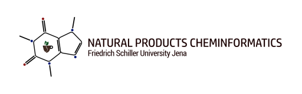
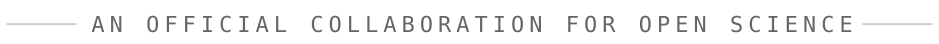

<div align="center">

<picture>
  <source media="(max-width: 700px)" srcset="assets/readme-banner-narrow.svg">
  
</picture>

<br>

<a href="https://orthonym.decimer.ai"></a>&nbsp;&nbsp;<a href="#quick-start"></a>

<br>

**A SMILES string goes in. A verified IUPAC name comes out, or a clear "no". Never a guess.**

[](LICENSE)
[](https://www.python.org/)
[](https://doi.org/10.1039/9781849733069)
[](https://github.com/Steinbeck-Lab/Orthonym/actions/workflows/ci.yml)
[](https://steinbeck-lab.github.io/Orthonym/)
[](https://doi.org/10.5281/zenodo.23044199)
[](https://github.com/Steinbeck-Lab/Orthonym-Web)
[](https://github.com/Kohulan/orthonym-skills)

</div>

<picture>
  <source media="(max-width: 700px)" srcset="assets/readme-gallery-narrow.svg">
  
</picture>

## Quick start

```bash
pip install orthonym                      # or: conda install -c conda-forge orthonym
orthonym --fetch-jars                     # one time: downloads and checks the OPSIN and centres jars
```

You need Python 3.10+ and a Java 11+ runtime on your `PATH` (the conda package brings Java with it).
More in [Install](guide/start/install.md).

```python
from orthonym import name_compound

name_compound("CCO")                          # 'ethanol'
name_compound("CC(=O)Oc1ccccc1C(=O)O")        # '2-(acetyloxy)benzoic acid'
name_compound("Cn1cnc2c1c(=O)n(C)c(=O)n2C")   # '1,3,7-trimethyl-3,7-dihydro-1H-purine-2,6-dione'
name_compound("C/C=C/C")                      # '(2E)-but-2-ene'
name_compound("C[C@H](O)CC")                  # '(2S)-butan-2-ol'
```

`name_compound` also takes an RDKit `Chem.Mol`, for example a molecule read from an SDF file.

```bash
orthonym "CCO"                                # ethanol
orthonym "CC(=O)Oc1ccccc1C(=O)O" --provenance # the name plus its tier and how it was checked, as JSON
orthonym --batch molecules.smi -o names.txt   # one SMILES per line
```

These commands use the default tier, which returns a verified Preferred IUPAC Name (PIN) or no name.
For the wider tier, add `--emit-tier best-effort` (one SMILES or `--batch`), or in Python
`Orthonym(general_fallback=True, allow_aromatic_general=True, general_fallback_unverified=True)`.
See [Output tiers](#output-tiers).

<picture>
  <source media="(max-width: 700px)" srcset="assets/readme-specimen-narrow.svg">
  
</picture>

<sub>Real output, generated from the engine. The tier at the right comes from <code>--provenance</code>.</sub>

## How names are checked

<picture>
  <source media="(max-width: 700px)" srcset="assets/readme-roundtrip-narrow.svg">
  
</picture>

- **Deterministic.** Names are built from the rules of the IUPAC 2013 recommendations (the "Blue
  Book"). No neural network, no sampling: the same input always gives the same name.
- **Checked.** [OPSIN](https://github.com/dan2097/opsin), which never saw your structure, reads
  every name back. The result must match your structure in constitution, charge and stereo. A few
  name forms OPSIN cannot read are checked another way, and `--provenance` marks them.
- **Honest.** A name that fails a check is withdrawn. When no name is left, Orthonym says so and
  gives the reason. It never guesses.

More in [How every name is checked](guide/checking.md) and [Declines](guide/declines.md).

## Output tiers

By default Orthonym returns only the Preferred IUPAC Name (PIN), verified, or no name. Wider tiers
are opt-in with `--emit-tier` (keyword switches of `Orthonym` in Python) and label every name
they return. The default is a rule about which names to return, not a limit of the engine. On 2,000
held-out ChEBI molecules the default tier names 1,106 (55.30 %) and declines 891, and
`--emit-tier best-effort` names 1,994 (99.70 %). A name counts only when OPSIN 2.9.0 reads it back
to the molecule ([both tiers on three sets](guide/accuracy.md#the-two-tiers)).

| `--emit-tier` | Returns |
|:--|:--|
| `pin` *(default)* | the verified PIN (with a few listed exceptions), or no name |
| `valid` | also other systematic names that OPSIN reads back to your structure |
| `complete` | also general names for aromatic and heterocyclic ring systems |
| `best-effort` | also the last-resort names, such as von Baeyer and spiro names for ring systems of up to 15 rings |
| `full-coverage` | also coordination names for metal tetrapyrrole and corrin complexes |

`--provenance` labels each name: `pin_verified` (the PIN, verified), `pin_unverified` (PIN form,
preferred status not certified), `systematic_verified` (a correct name that is not the PIN),
`best_effort` (a last-resort name) or `abstain` (no name). Metal compounds are admitted one metal
at a time. The exceptions, the labels and the metals are in [Output tiers](guide/tiers.md).

## Documentation

- [Docs site](https://steinbeck-lab.github.io/Orthonym/): install, use, tiers, provenance, reference.
- [How it works](guide/how-it-works.md) · [How accuracy is measured](guide/accuracy.md) ·
  [Contributing](CONTRIBUTING.md) · [Changelog](CHANGELOG.md) · [Security](SECURITY.md) ·
  [Code of conduct](CODE_OF_CONDUCT.md)
- Found a wrong name? [Open an issue](https://github.com/Steinbeck-Lab/Orthonym/issues/new/choose).

## How Orthonym was built

Orthonym was built with [Claude Code](https://docs.claude.com/en/docs/claude-code) under a fixed
set of working rules, published as [**orthonym-skills**](https://github.com/Kohulan/orthonym-skills)
(20 skills, 2 hooks, 1 agent). Each rule makes a step rest on a measurement instead of a guess: fixed
test sets before and after each change, proof that the code to change is on the execution path, a
primary source before an expected value in a test changes, a regression gate before every merge,
and a written handoff between sessions.

## How to cite

Please cite the preprint:

> Rajan, K.; Zielesny, A.; Steinbeck, C. Orthonym: verified IUPAC names for chemical structures in
> the wild. *ChemRxiv* **2026**. [doi:10.26434/chemrxiv.15009769/v1](https://doi.org/10.26434/chemrxiv.15009769/v1)

```bibtex
@article{rajan2026orthonym,
  author  = {Rajan, Kohulan and Zielesny, Achim and Steinbeck, Christoph},
  title   = {{Orthonym}: verified {IUPAC} names for chemical structures in the wild},
  journal = {ChemRxiv},
  year    = {2026},
  doi     = {10.26434/chemrxiv.15009769/v1}
}
```

To cite the software version you used, cite its Zenodo archive:

<!-- x-release-please-start-version -->
```bibtex
@software{orthonym,
  author  = {Rajan, Kohulan and Zielesny, Achim and Steinbeck, Christoph},
  title   = {{Orthonym}},
  version = {1.0.9},
  year    = {2026},
  doi     = {10.5281/zenodo.23044199},
  url     = {https://github.com/Steinbeck-Lab/Orthonym}
}
```
<!-- x-release-please-end -->

Every release is archived on Zenodo. The DOI [10.5281/zenodo.23044199](https://doi.org/10.5281/zenodo.23044199)
stands for all versions and resolves to the newest one.

## Built on

Orthonym stands on the IUPAC 2013 recommendations and on open cheminformatics software:
[RDKit](https://www.rdkit.org/) reads the structure, [OPSIN 2.9.0](https://github.com/dan2097/opsin)
reads the names back to check them, and [centres 1.2.1](https://github.com/SiMolecule/centres)
assigns the CIP descriptors. Without them there would be no Orthonym. `orthonym --opsin main` reads
the names back with OPSIN's main branch instead, built on your machine with a JDK
([Install](guide/start/install.md#choosing-the-opsin-version)); only then are phane names built for
cyclophanes and linear phanes ([Phane names](guide/use/phane-names.md)).

> Favre, H. A.; Powell, W. H. *Nomenclature of Organic Chemistry: IUPAC Recommendations and
> Preferred Names 2013*. Royal Society of Chemistry, **2013**.
> [doi:10.1039/9781849733069](https://doi.org/10.1039/9781849733069)
>
> Lowe, D. M.; Corbett, P. T.; Murray-Rust, P.; Glen, R. C. Chemical Name to Structure: OPSIN,
> an Open Source Solution. *J. Chem. Inf. Model.* **2011**, 51 (3), 739–753.
> [doi:10.1021/ci100384d](https://doi.org/10.1021/ci100384d)
>
> Hanson, R. M.; Musacchio, S.; Mayfield, J. W.; Vainio, M. J.; Yerin, A.; Redkin, D. Algorithmic
> Analysis of Cahn–Ingold–Prelog Rules of Stereochemistry: Proposals for Revised Rules and a Guide
> for Machine Implementation. *J. Chem. Inf. Model.* **2018**, 58 (9), 1755–1765.
> [doi:10.1021/acs.jcim.8b00324](https://doi.org/10.1021/acs.jcim.8b00324)

## Licence

MIT, see [LICENSE](LICENSE). The OPSIN and centres jars are not part of this repository; they are
downloaded from their official releases and keep their own licences (see [`NOTICE`](NOTICE)).

<div align="center">
<br>
<sub>Made with  by <a href="https://www.kohulanr.com/">Kohulan Rajan</a> at</sub>
<br><br>
<a href="https://www.beilstein-institut.de/en/"></a>

<a href="https://cheminf.uni-jena.de"></a>
<br><br>
<picture>
  <source media="(max-width: 700px) and (prefers-color-scheme: dark)" srcset="assets/readme-collab-line-narrow-dark.svg">
  <source media="(max-width: 700px)" srcset="assets/readme-collab-line-narrow.svg">
  <source media="(prefers-color-scheme: dark)" srcset="assets/readme-collab-line-dark.svg">
  
</picture>
</div>
